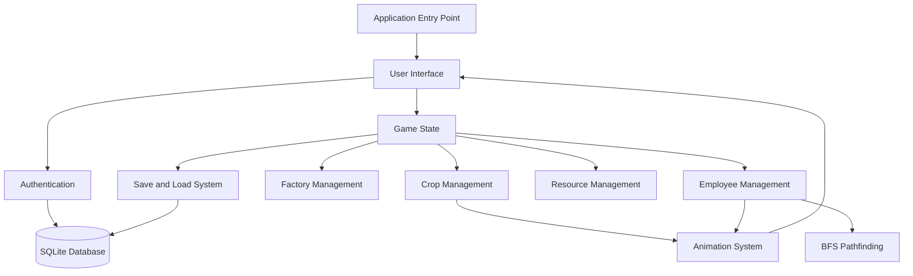
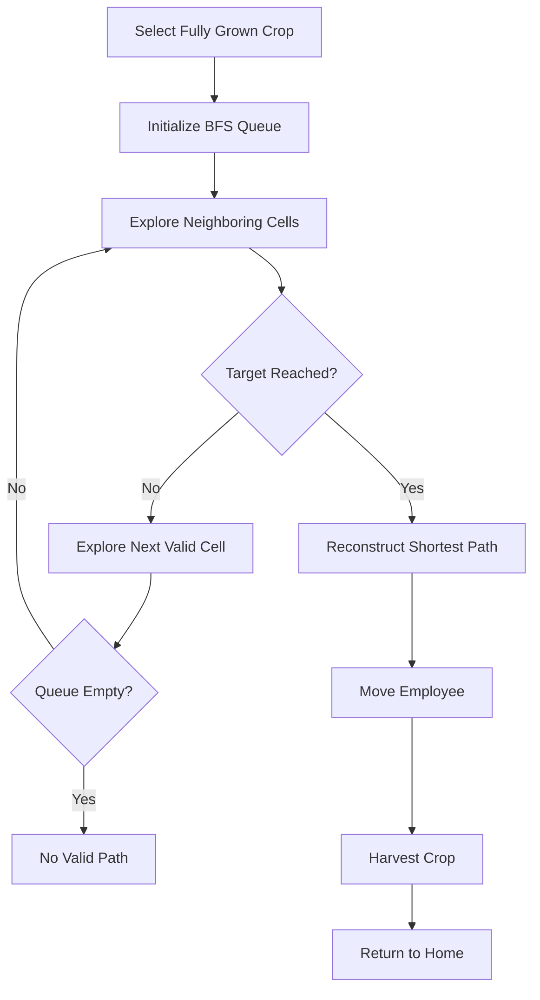

# Farming Empire


A 2D farming and resource management simulation game built with Python, Arcade, and SQLite.

Farming Empire combines strategic resource management, crop cultivation, industrial development, automated workers, and graph-based pathfinding in an interactive desktop application.

Players manage a farming environment, cultivate crops, develop factories, automate harvesting operations, and progress through increasingly advanced gameplay levels.

The project demonstrates object-oriented programming, algorithm implementation, event-driven development, database integration, and modular software architecture.

---

## Table of Contents

- [Project Overview](#project-overview)
- [Key Features](#key-features)
- [Technical Highlights](#technical-highlights)
- [Technology Stack](#technology-stack)
- [Software Architecture](#software-architecture)
- [Project Structure](#project-structure)
- [Installation](#installation)
- [Running the Application](#running-the-application)
- [Gameplay Guide](#gameplay-guide)
- [Game Mechanics](#game-mechanics)
- [Pathfinding Algorithm](#pathfinding-algorithm)
- [Database and Persistence](#database-and-persistence)
- [Security and Current Limitations](#security-and-current-limitations)
- [Development Roadmap](#development-roadmap)
- [Skills Demonstrated](#skills-demonstrated)
- [Acknowledgments](#acknowledgments)
- [Usage and Licensing](#usage-and-licensing)

---

## Project Overview

**Farming Empire** is a single-player desktop management simulation that allows players to build and develop a farming enterprise through strategic decisions, resource allocation, and automated operations.

The game takes place on an interactive 8 × 8 grid, where players manage crops, factories, employees, and available resources.

The gameplay is structured around two progressive levels:

| Level | Objective |
|---|---|
| Level 1 | Crop cultivation, harvesting, and resource accumulation |
| Level 2 | Industrial expansion, factory management, and employee automation |

The application integrates a graphical user interface, game logic, pathfinding algorithms, animation management, authentication, and persistent database storage.

---

## Key Features

### Farming and Crop Management

- Interactive 8 × 8 farming grid.
- Multiple crop growth stages.
- Crop planting, replacement, and harvesting.
- Automated crop regeneration.
- Time-based crop growth cycles.
- Dynamic resource consumption and generation.

### Factory Management

- Factory placement and replacement.
- Factory upgrades to increase productivity.
- Periodic industrial resource generation.
- Strategic resource investment.
- Progressive industrial development.

### Automated Employee System

- Employee activation through the Home tile.
- Automated navigation using Breadth-First Search (BFS).
- Shortest-path calculation on an unweighted grid.
- Automated crop harvesting.
- Animated employee movement.
- Automatic return to the Home tile after completing tasks.

### Resource Management

Three primary resources are managed throughout the game:

- Food
- Water
- Coins

Resource operations include:

- Resource expenditure validation.
- Periodic reward generation.
- Factory production rewards.
- Crop harvesting rewards.
- Prevention of negative resource balances.

### User Authentication

- User registration.
- User login.
- User-specific saved games.
- Local database integration.

### Save and Load System

- Persistent gameplay snapshots.
- Multiple saved games.
- Restoration of game resources and grid state.
- Restoration of progression levels.
- User-specific save history.

### Interactive User Interface

- Real-time resource dashboard.
- Context-based gameplay controls.
- Crop and factory selection panels.
- Level objectives and instructions.
- Animated sprites and gameplay elements.
- Save and exit operations.

---

## Technical Highlights

| Technical Area | Implementation |
|---|---|
| Programming Paradigm | Object-Oriented Programming |
| Pathfinding | Breadth-First Search (BFS) |
| Game Architecture | Modular separation of concerns |
| Database | SQLite relational database |
| Data Serialization | JSON-based gameplay snapshots |
| User Interface | Arcade graphical framework |
| Event Handling | Event-driven game interactions |
| Animation | Frame-based sprite animations |
| State Management | Centralized game state |
| Persistence | Local database storage |
| Resource Validation | Guarded resource transactions |
| Game Progression | Level-based progression system |

---

## Technology Stack

| Technology | Version | Purpose |
|---|---|---|
| Python | 3.12.10 | Core application development |
| Arcade | 3.3.2 | 2D rendering and game development |
| SQLite | Built-in | Persistent database storage |
| sqlite3 | Python standard library | Database operations |
| JSON | Python standard library | Game state serialization |
| Pillow | Arcade dependency | Image processing |
| BFS | Custom implementation | Employee pathfinding |

Project dependencies are maintained in `requirements.txt`.

---

## Software Architecture

The application follows a modular architecture that separates presentation, game logic, authentication, and persistence.



### Presentation Layer

Responsible for graphical rendering, user interactions, navigation, interface components, and visual feedback.

### Game Logic Layer

Responsible for:

- Gameplay rules.
- Resource allocation.
- Crop growth.
- Factory operations.
- Employee behavior.
- Level progression.
- Game state management.

### Authentication Layer

Handles user registration, login, and user identification.

### Persistence Layer

Manages SQLite database operations, gameplay serialization, saved game retrieval, and state restoration.

---

## Project Structure

```text
FarmingEmpire/
│
├── main.py
│
├── assets/
│   ├── images/
│   └── sounds/
│
├── auth/
│   ├── login.py
│   ├── register.py
│   └── user_model.py
│
├── database/
│   ├── db_setup.py
│   └── game_data.db
│
├── game/
│   ├── banimations.py
│   ├── cell.py
│   ├── crops.py
│   ├── employees.py
│   ├── factories.py
│   ├── game_state.py
│   └── resources.py
│
├── ui/
│   ├── animations.py
│   ├── drawing_helpers.py
│   ├── game_menu_view.py
│   ├── game_ui_utils.py
│   ├── game_window.py
│   ├── icons.py
│   ├── login_view.py
│   ├── menu_view.py
│   ├── register_view.py
│   ├── saves_view.py
│   └── theme.py
│
├── requirements.txt
└── README.md
```

### Directory Responsibilities

| Directory | Responsibility |
|---|---|
| `assets/` | Images, sprites, and audio resources |
| `auth/` | User authentication and account management |
| `database/` | Database initialization and persistent storage |
| `game/` | Core gameplay logic and algorithms |
| `ui/` | Graphical interface and presentation components |

The local database file is automatically generated at runtime if it does not exist.

### Asset Requirements

Graphical assets are stored in `assets/images/`.

The employee sprite sheet uses a grid of 2 columns and 12 rows, with the first 16 frames used for walking and harvesting animations.

Crop growth stage images and the Home tile icon are also required.

---

## Installation

### Prerequisites

Ensure the following software is installed:

- Python 3.12
- Git
- pip
- A desktop environment compatible with Arcade

The application has been tested on Windows. macOS and Linux compatibility has not been independently verified.

### 1. Clone the Repository

```bash
git clone https://github.com/YOUR_USERNAME/farming-empire.git
cd farming-empire
```

### 2. Create a Virtual Environment

#### Windows

```powershell
py -3.12 -m venv .venv
.venv\Scripts\Activate.ps1
```

#### macOS / Linux

```bash
python3.12 -m venv .venv
source .venv/bin/activate
```

### 3. Install Dependencies

```bash
python -m pip install --upgrade pip
pip install -r requirements.txt
```

### 4. Database Initialization

The application automatically initializes the SQLite database during its first execution if the database file does not exist.

```text
database/game_data.db
```

No external database server is required.

---

## Running the Application

From the project root directory, activate the virtual environment and execute:

```bash
python main.py
```

The application launches a desktop window titled **Farming Empire**.

Users can register a local account, log in, start a new game, or restore a previously saved session.

---

## Gameplay Guide

### Getting Started

1. Launch the application.
2. Register a local user account or log in.
3. Select **New Game** to start a new session.
4. Alternatively, select **Load Game** to restore an existing save.
5. Manage resources and complete level objectives.

### Level 1 — Farming Development

The initial level focuses on crop cultivation and resource accumulation.

Available operations include:

- Planting crops on empty tiles.
- Replacing existing crops.
- Harvesting crops.
- Accumulating food, water, and coins.

To unlock Level 2:

- Plant at least 10 crops.
- Earn at least 60 units of each resource since the beginning of Level 1.

### Level 2 — Industrial Expansion

The second level introduces advanced resource management and automation.

Available operations include:

- Placing factories.
- Replacing factories.
- Upgrading factories.
- Activating employees.
- Automating crop harvesting.
- Increasing periodic resource production.

### Employee Activation

1. Select the Home tile located at grid coordinate `(0, 0)`.
2. Select a fully grown crop.
3. The employee calculates a shortest available path.
4. The employee navigates to the selected crop.
5. The crop is harvested.
6. The employee returns to the Home tile.

### Controls

| Action | Control |
|---|---|
| Select a grid tile | Mouse click |
| Plant a crop | Plant Crop button |
| Replace a crop | Replace Crop button |
| Place a factory | Place Factory button |
| Upgrade a factory | Upgrade Factory button |
| Activate employee | Click Home tile |
| Assign employee | Click fully grown crop |
| Save progress | Save button |
| Exit application | Quit button |

---

## Game Mechanics

### Grid System

- Grid dimensions: 8 × 8.
- Total grid cells: 64.
- Home tile location: `(0, 0)`.
- The Home tile cannot contain crops or factories.
- Employee navigation is restricted to valid grid positions.

### Resource Costs

| Operation | Food | Water | Coins |
|---|---:|---:|---:|
| Plant Crop | 2 | 2 | 2 |
| Replace Crop | 1 | 1 | 1 |
| Place Factory | 5 | 5 | 5 |
| Upgrade Factory | 10 × current level | 10 × current level | 10 × current level |

### Resource Rewards

| Operation | Food | Water | Coins |
|---|---:|---:|---:|
| Replace Factory | +3 | +3 | +3 |
| Level 1 Factory Production | +2 | +2 | +2 |
| Level 2 Factory Production | +3 | +3 | +3 |

Factory production rewards are generated during the periodic reward cycle.

### Timing System

| Event | Duration |
|---|---|
| Crop growth cycle | Approximately 50 seconds |
| Crop regeneration delay | Approximately 2 seconds |
| Periodic reward cycle | 60 seconds |
| Employee movement | Frame-based |
| Harvest animation | Frame-based |

### Employee Management

- One employee is gained after every two factory placements.
- One employee is removed after every two factory removals.
- Employee availability never falls below zero.
- Approximately five workers can operate simultaneously.

### Resource Validation

Resource expenditure is validated before executing gameplay operations.

This prevents negative resource balances and ensures operations are performed only when sufficient resources are available.

---

## Pathfinding Algorithm

Farming Empire uses **Breadth-First Search (BFS)** to calculate employee navigation paths across the game grid.

BFS is a graph traversal algorithm that explores neighboring nodes level by level. It guarantees a shortest path in an unweighted graph when a valid path exists.

### Implementation Characteristics

- Four-directional movement.
- Unweighted grid traversal.
- Obstacle-aware navigation.
- Shortest-path calculation.
- Visited-node tracking.
- Path reconstruction.
- Employee navigation and return operations.

### Pathfinding Workflow



### Example Navigation Grid

```text
H  *  *  .  .  .  .  .
.  X  *  X  .  .  .  .
.  .  *  *  C  .  .  .
.  .  X  .  .  .  .  .
.  .  .  .  .  .  .  .
.  .  .  .  .  .  .  .
.  .  .  .  .  .  .  .
.  .  .  .  .  .  .  .
```

Legend:

- `H` — Home tile
- `C` — Target crop
- `X` — Obstacle
- `*` — Calculated path
- `.` — Available cell

### Algorithm Complexity

For an unweighted graph:

- Time complexity: `O(V + E)`
- Space complexity: `O(V)`

Where:

- `V` represents the number of vertices.
- `E` represents the number of edges.

BFS provides a practical and predictable navigation solution for the game's compact grid environment.

---

## Database and Persistence

The application uses SQLite for local data persistence.

SQLite provides a lightweight relational database solution without requiring an external database server.

### User Data

The database stores:

- User identifiers.
- Usernames.
- Email addresses.
- Authentication credentials.

### Game Save Data

Each gameplay snapshot contains:

- Associated username.
- Current gameplay level.
- Resource balances.
- Grid configuration.
- Level progression baselines.
- Save timestamp.

### Database Schema

#### Users Table

| Column | Description |
|---|---|
| `id` | Primary key |
| `username` | Unique username |
| `email` | User email address |
| `password` | Authentication credential |

#### Saves Table

| Column | Description |
|---|---|
| `id` | Primary key |
| `username` | Associated username |
| `level` | Current gameplay level |
| `resources` | Serialized resource data |
| `grid` | Serialized grid configuration |
| `level1_start` | Level 1 resource baseline |
| `level2_start` | Level 2 resource baseline |
| `save_time` | Save creation timestamp |

### Save and Load Workflow


Gameplay data is serialized into JSON and stored in SQLite, allowing the application to restore saved gameplay snapshots.

---

## Security and Current Limitations

The current implementation is intended for local desktop use and is not production-ready.

Identified limitations include:

- Authentication passwords are currently stored in plaintext.
- Password hashing and login throttling are not implemented.
- Database relationships are managed through application logic rather than explicit foreign key constraints.
- Gameplay snapshots use JSON serialization rather than fully normalized database tables.
- Employee pathfinding does not include multi-agent collision avoidance.
- Automated unit and integration testing have not yet been implemented.
- Application compatibility has primarily been tested on Windows.
- Cloud synchronization and multiplayer functionality are not supported.

Use demonstration credentials only. Do not reuse passwords associated with real accounts.

Local databases containing account information should not be committed to public repositories.

---

## Development Roadmap

### Security and Authentication

- [ ] Implement secure password hashing using Argon2id or bcrypt.
- [ ] Add login attempt throttling.
- [ ] Improve authentication validation.
- [ ] Strengthen database integrity constraints.

### Software Quality

- [ ] Introduce automated unit tests.
- [ ] Add integration tests for database operations.
- [ ] Improve exception handling and logging.
- [ ] Introduce continuous integration with GitHub Actions.
- [ ] Apply consistent formatting and static code analysis.

### Artificial Intelligence and Algorithms

- [ ] Evaluate A* pathfinding for larger or weighted environments.
- [ ] Implement employee task queues.
- [ ] Introduce task prioritization.
- [ ] Implement multi-agent collision avoidance.

### Gameplay Improvements

- [ ] Add additional crop types.
- [ ] Introduce advanced factory levels.
- [ ] Expand gameplay progression.
- [ ] Add configurable game speeds.
- [ ] Introduce additional management challenges.

### User Experience

- [ ] Interactive onboarding tutorial.
- [ ] Improved tooltips and visual feedback.
- [ ] Accessibility-oriented color palettes.
- [ ] Automatic saving.
- [ ] Configurable save slots.

### Deployment

- [ ] Package the application as a standalone desktop executable.
- [ ] Verify cross-platform compatibility.
- [ ] Create versioned GitHub releases.

---

## Skills Demonstrated

This project demonstrates practical software development capabilities across several technical areas.

### Software Engineering

- Object-oriented programming.
- Modular application architecture.
- Separation of concerns.
- State management.
- Event-driven programming.
- Resource validation.
- Code organization and maintainability.

### Algorithms and Data Structures

- Breadth-First Search.
- Graph traversal.
- Queue-based algorithms.
- Grid navigation.
- Shortest-path calculation.
- Algorithm complexity analysis.

### Database Development

- SQLite integration.
- Relational database design.
- Database initialization.
- User account persistence.
- JSON serialization and deserialization.
- Game state storage and restoration.

### Game Development

- 2D graphical rendering.
- Sprite-based animation.
- Real-time gameplay updates.
- Timer-based mechanics.
- User interaction handling.
- Automated character movement.
- Simulation and resource management.

### User Interface Development

- Interactive desktop interfaces.
- Navigation between application views.
- Dashboard development.
- Context-sensitive controls.
- Dynamic visual feedback.

---

## Acknowledgments

This project utilizes technologies and resources maintained by the open-source development community.

- [Python](https://www.python.org/)
- [Arcade](https://api.arcade.academy/)
- [SQLite](https://www.sqlite.org/)
- [Pillow](https://python-pillow.org/)

---

## Usage and Licensing

No open-source license is granted through this README.

Use, redistribution, and modification of the source code and graphical assets remain subject to the applicable rights and permissions.

---

<p align="center">
  <strong>Farming Empire</strong>
  <br>
  Strategy · Automation · Algorithms · Software Engineering
</p>
